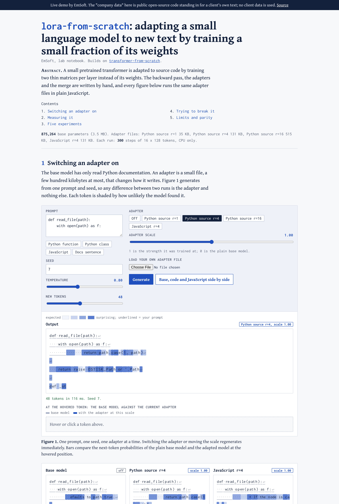
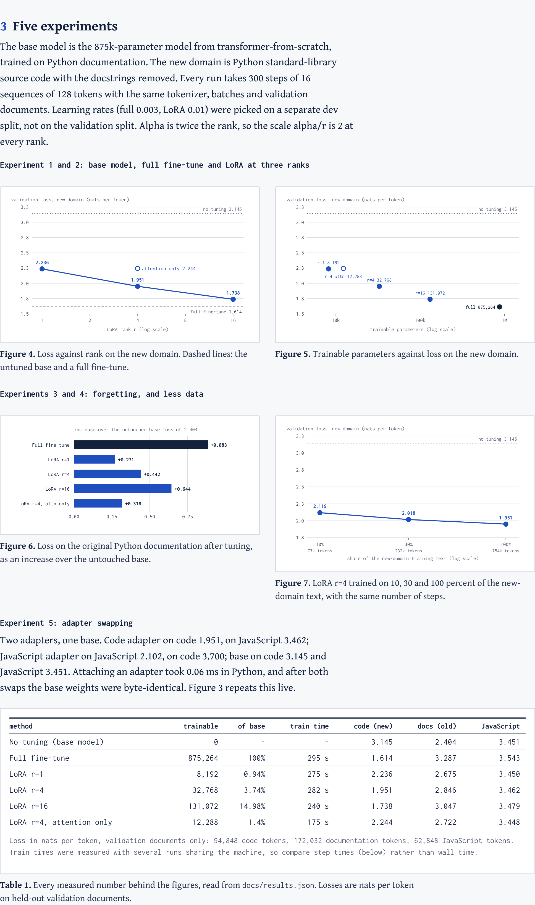
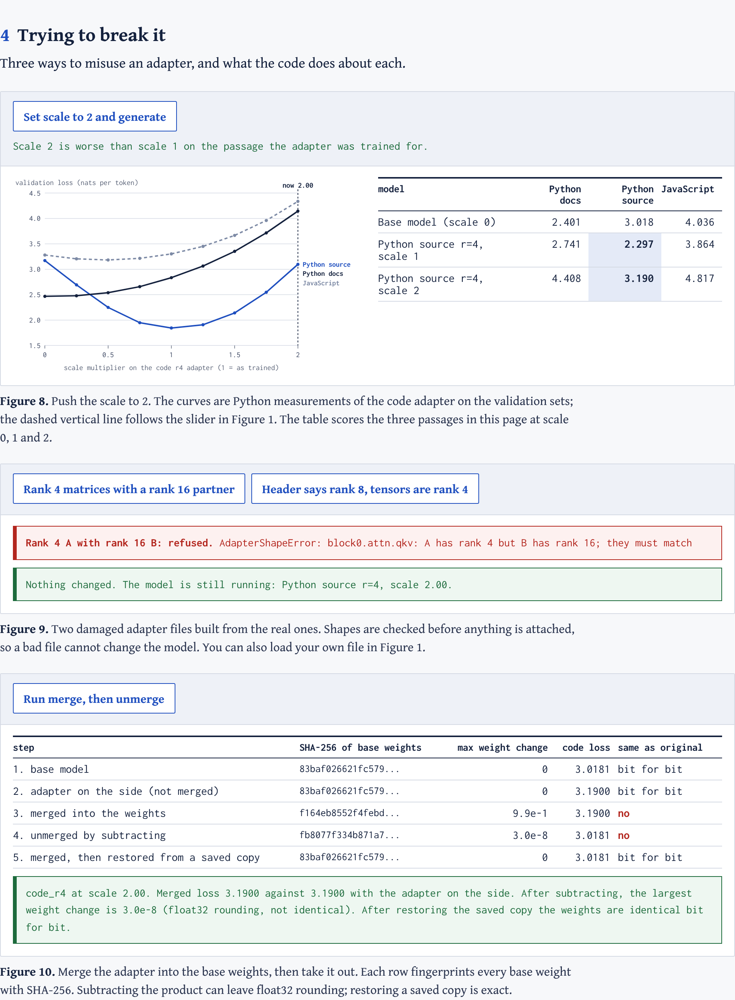

# lora-from-scratch: fine-tune a language model on your own text by training a few percent of it

Fine-tuning a whole model on a company's own data is slow, costly and makes the model forget what it knew. This repo does it with LoRA adapters instead, written by hand in numpy (forward, backward, merge), measured against full fine-tuning, and running live in your browser.

**▶ Live demo: https://enxo7899.github.io/lora-from-scratch/** (press Generate, then switch the adapter on and press it again)



Builds on [transformer-from-scratch](https://github.com/enxo7899/transformer-from-scratch) (my own MIT repo): its numpy model package is copied into `src/tiny_gpt/` and its pretrained 875k-parameter weights are the frozen base. Changes to the copied code: a `trainable` flag, an optional `lora` slot on `Linear`, and `apply()` in the cached decoder.

## What it does

| Capability | Detail |
|---|---|
| LoRA in numpy | `y = xW + b + (alpha/r)(xA)B` on the attention and MLP projections, `B` starts at zero, `alpha = 2r` |
| Hand-written backward | `dA`, `dB` and the input gradient, checked against finite differences (layer, whole model, random ranks and scales) |
| Frozen base | Only `A` and `B` reach the optimiser; a test hashes the base before and after training |
| Merge and unmerge | Fold `(alpha/r)AB` into `W` and take it out; exact restore from a backup, or subtract with a measured rounding error |
| Adapter files | `.lora` files of 35 KB to 515 KB, shape-checked before anything is attached |
| Browser | Same forward pass in JavaScript with a LoRA branch; switch adapters, scale 0 to 2, per-token probability chips |
| Try to break it | Scale 2, mismatched ranks, merge then unmerge with SHA-256 of every base weight |
| Parity | Node tests compare logits, greedy text and held-out losses with Python's float64 output |

## Measured results

Base model on Python documentation (the old domain). New domain: Python standard-library source with docstrings removed. Second domain for the swapping test: JavaScript from MIT-licensed packages (`data/README.md`). Same tokenizer, same seeded batches, 300 steps of 16 x 128 tokens per run, same validation documents. Learning rates were chosen per method on a separate dev split. Source: `docs/results.json`, produced by `python3 scripts/experiments.py all`.

| Method | Trainable | Code loss (new) | Docs loss (old) | Train time |
|---|---|---|---|---|
| No tuning | 0 | 3.145 | 2.404 | - |
| Full fine-tune | 875,264 (100%) | 1.614 | 3.287 | 295 s |
| LoRA r=1 | 8,192 (0.94%) | 2.236 | 2.675 | 275 s |
| LoRA r=4 | 32,768 (3.74%) | 1.951 | 2.846 | 282 s |
| LoRA r=16 | 131,072 (14.98%) | 1.738 | 3.047 | 240 s |
| LoRA r=4, attention only | 12,288 (1.4%) | 2.244 | 2.722 | 175 s |

Loss is nats per token on held-out documents (lower is better).

- **Data efficiency** (LoRA r=4, same steps): 10% of the text 2.119, 30% 2.018, 100% 1.951.
- **Adapter swapping** on one base: the code adapter scores 1.951 on code and 3.462 on JavaScript; the JavaScript adapter 2.102 on JavaScript and 3.700 on code. Base: 3.145 and 3.451. After both swaps the base weights were byte-identical. Attaching took 0.06 ms.
- **Scale**: on the code adapter, code loss is 1.844 at scale 1 and 3.097 at scale 2 (base 3.171 on the same windows); docs loss climbs from 2.467 to 4.145.
- **Merge**: merged and live adapter give the same loss (1.84363). Subtracting leaves up to 3e-8 weight difference; restoring from a backup is bit for bit.
- **Step time** back to back on a quiet-ish machine: full 0.554 s, LoRA r=1/4/16 0.583 / 0.574 / 0.626 s.

**Where LoRA loses.** Full fine-tuning reaches 1.614 on the new domain; the best LoRA (r=16, 15% of the weights) reaches 1.738, a gap of 0.124 nats. LoRA r=4 is 0.337 behind. It also forgets less (the old-domain loss rises by 0.27 to 0.64 against 0.88 for full fine-tuning), but it forgets too: no setting kept the old loss at 2.404. LoRA is not faster per step here: it still pushes gradients through every layer, and the extra small matmuls cost about as much as the skipped weight gradients on a model this small.



## How it works

```
 data/*.txt ─► split by document ─► base tokenizer (unchanged) ─► token ids
 model/weights.bin (frozen) ──► Linear: xW + b  (+ s * (xA)B)  ◄── only A, B trained (AdamW)
                                                     │
          merge / unmerge ◄──────────── model/adapters/*.lora (35 KB to 515 KB)
                                                     │
   web/model.js (same maths) ─► page; node --test checks Python logits to 1e-3
```

Details and trade-offs are in `docs/DESIGN.md`.



## Limits

- Teaching size: under a million parameters, 1.5 MB of text per domain, one seed per setting. Differences of a few thousandths of a nat are not evidence.
- The tokenizer was trained on documentation and is poor at code, which caps what any method can reach.
- Full-run training time was measured with three runs sharing the machine with other jobs. The nine learning-rate runs and eight main runs add up to about 55 minutes of run time (about 25 minutes of wall clock); the per-run times above are therefore noisy, which is why the step-time benchmark is reported too.
- The learning rate for full fine-tuning landed at the upper edge of the grid I tried (3e-3 against 1e-3 within 0.01 dev loss); a larger grid might help it slightly.
- Only perplexity is measured, no task evaluation. Generated text is fluent fragments, not working code.
- The browser tolerance against Python is 1e-3 on logits (float32 weights, float64 arithmetic); the merged path adds a float32 rounding step.

## Run it

```bash
pip install -e ".[dev]"          # numpy at runtime, pytest for tests
npm test                          # pytest (gradient checks, merge, shapes, data) then node --test (JS parity)
npm run dev                       # http://127.0.0.1:5190/
npm run experiments               # about 40 minutes on a free 4-core machine; rewrites docs/results.json, model/adapters, parity
npm run screenshots               # needs the dev server running; Playwright installed globally
python3 data/build_domains.py     # rebuild the new-domain text from the local Python and npm installs
```

Run only some experiments: `python3 scripts/experiments.py train lora_r4 full` (results are cached in `runs/`), then `python3 scripts/experiments.py assemble`.

## Adapt it to your business

Put your documents in `data/mytext.txt` (separated by a `<<<DOC>>>` line), load it with `lora_scratch.finetune.load_domain`, train with `train_lora`, and save with `save_adapter`. Drop the `.lora` file next to the others and add it to the list at the top of `web/app.js`. For a real client you would use a larger base model; `docs/DESIGN.md` lists what changes.

---
Built by **[EmSoft](https://github.com/enxo7899)**: Python and machine-learning engineering, including fine-tuning models on a company's own data. Get in touch through my Fiverr or Upwork profile.
